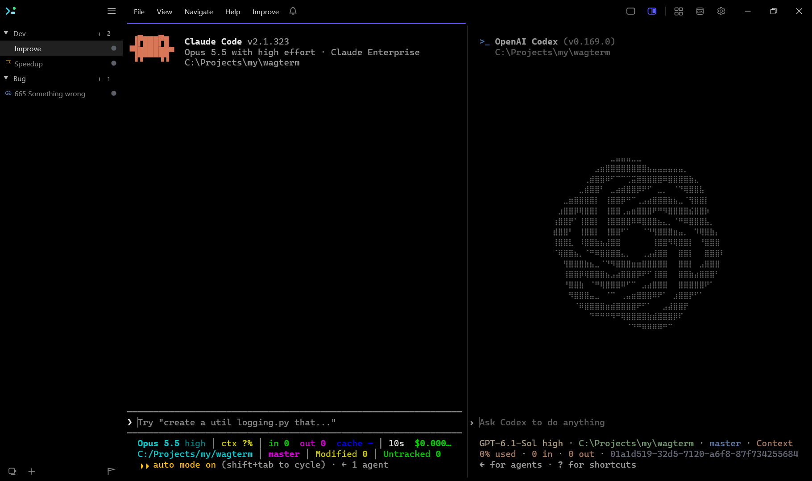
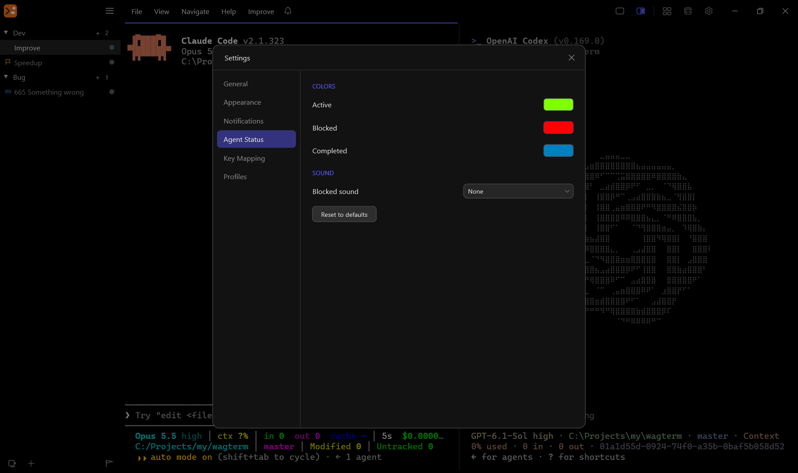
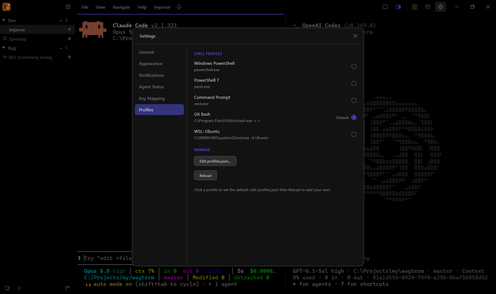

# WagTerm - a native Windows terminal built for AI coding agents

[](https://github.com/msize/wagterm/actions/workflows/ci.yml)
[](https://scorecard.dev/viewer/?uri=github.com/msize/wagterm)
[](https://github.com/msize/wagterm/releases)
[](https://github.com/msize/wagterm/releases)
[](LICENSE)

**[Releases](https://github.com/msize/wagterm/releases)** · [User guide](docs/user-guide.md) · [Control API](docs/control-api.md) · [agliteterm](https://github.com/yeroo/agliteterm)

**WagTerm** is a Windows terminal for AI coding agents, forked from [agwinterm](https://github.com/yeroo/agwinterm) with an independently maintained feature set by **msize**.

It has a full control API in a fast, custom-drawn Win32 + Direct2D shell. Shells are organized into workspaces, each holding the sessions for one project or context, and everything it holds is an object a script can address. The bundled `wagtermctl` creates sessions and types into them, reads a pane's text back, runs a program in an overlay and returns its exit status, sets a session's status, opens a dashboard, moves windows, and reads all of that state back out over a local named pipe.

The motivation is the one behind [umputun's agterm](https://github.com/umputun/agterm), which this project follows on Windows: running several coding agents at once means many long-lived sessions, each progressing on its own, and a tabbed terminal loses track of them quickly. Each agent works in a named session and reports whether it is active, blocked, or done, so it is obvious which one needs you. An installable skill teaches an agent the control model, so it can drive the terminal itself.

The upstream agwinterm is a from-scratch implementation in C# (agterm is Swift on libghostty), not a port of agterm's source code. WagTerm builds on agwinterm's code. It can be the OS default terminal, is usable with a screen reader, and works as an everyday terminal without agent integrations. On macOS, use the original: **[github.com/umputun/agterm](https://github.com/umputun/agterm)**.

## Independent identity

WagTerm and agwinterm can be installed and run side by side. WagTerm uses `wagterm.exe`, `wagtermctl`, `%LOCALAPPDATA%\wagterm`, the `wagterm` control pipe, `WAGTERM_*` session variables and `WAG_*` custom-command variables. Debug builds use `wagterm-dev`.

WagTerm does not import or modify agwinterm's profile, reuse its installer or default-terminal class identity, or read its update feed. Its opt-in hooks and shell integrations have separate file names and markers. Existing scripts must explicitly switch to WagTerm's CLI and environment variables. Windows still has only one selected default terminal.

What it does:

- **Workspaces and sessions.** Sessions are grouped under named workspaces in a sidebar with drag-reorder, flags, unread badges, multi-select, and reopen for closed sessions and workspaces. A live **dashboard** shows a grid of sessions at once.
- **Control API and CLI.** `wagtermctl` drives almost everything over a named pipe, with full read-back: the tree with split ratios and pane ids, window state, session output, a pane's caret column, the age of a status.
- **Splits, scratch, quick terminal and overlays.** Split a session side by side or stacked, open a scratch or a detached quick terminal, run a program in an overlay over a session or over one pane of it, or show a passive HUD.
- **Agent status and skill.** Agents report their state through hooks or the API as a colored dot and a title-bar bell. Opt-in installers add the agent skill, Claude Code / Codex / Devin status hooks, shell integration and the CLI on `PATH`.
- **Claude Code binding and auto-resume.** A `claude` wrapper ties each conversation to its pane, so a restart re-launches every bound pane and the conversation comes back. Updating Claude Code restarts every running Claude session into its own conversation.
- **Restore, and shells that survive the UI.** Sessions come back with their layout and pinned commands, and with captured commands when `restore-commands` is on. The experimental pty-host server mode keeps every shell running through a UI quit, update or crash.
- **A real Windows terminal.** Default Terminal Application registration, ~33k lines/s output, Sixel and Kitty graphics, the Kitty keyboard protocol, ligatures, elevated and de-elevated sessions side by side, and agterm's menus — File, View, Navigate, Help — as a menu bar in the title bar (Alt or F10).
- **Accessible.** The terminal is a UIA text document for Narrator and NVDA, every control is in the UIA tree, and new output is announced.
- **Themes.** ~580 bundled themes retint the whole window, fonts apply live, and an optional mode follows Windows light/dark.

A lot of "does it have X?" questions have the same answer: bind X yourself. A `command` line in `keymap.conf` names any shell line and a `map` line binds it to a key chord or leader chord, and an overlay gives an interactive program a real terminal over the session, so a git UI or a file manager is two lines away. Install the agent skill and ask the agent in your session for what you want; it knows the syntax.



<details>
<summary>More screenshots</summary>

The Settings window, on the Agent Status tab, where the status colors and the blocked sound are chosen:



shell profiles configuration:



</details>

## The model

- **Window.** A top-level bundle of workspaces and sessions with its own sidebar; `wagtermctl window` addresses each one.
- **Workspace.** A named group of sessions for one project or context.
- **Session.** One running shell with a name, a working directory, an optional one-line context, and its own scrollback. It is the row you see in the sidebar, and it keeps running while you work in another one.
- **Split, scratch and quick.** A session can split into two shells side by side or stacked, both sharing its one sidebar row. A scratch terminal opens over it for a quick aside; the quick terminal is a detached window of its own.
- **Overlay.** One program running in a temporary terminal over a session, or over one pane of a split. It disappears when the program exits (unless opened with `--wait`, which keeps it until closed) and leaves the shell underneath unchanged.

## Install

Release builds target **Windows x64**. Both artifacts are self-contained (no .NET runtime needed) and need no admin rights.

Releases are published in **[msize/wagterm](https://github.com/msize/wagterm/releases)**. The upstream agwinterm packages do not install WagTerm. Scoop, winget and Chocolatey registration for WagTerm is separate and is not assumed to exist.

Direct download, from the [releases page](https://github.com/msize/wagterm/releases):

- **`wagterm-setup-<version>.exe`** — per-user installer (Start-menu shortcut and uninstaller).
- **`wagterm-portable-<version>-win-x64.exe`** — a single self-contained exe, no installation; settings still live under `%LOCALAPPDATA%\wagterm`.

Package-publishing workflows are disabled until WagTerm has its own package registrations and credentials.

Binaries are currently **unsigned**, so SmartScreen warns on first run → *More info → Run anyway*. Release artifacts carry **Sigstore build-provenance attestations**:

```powershell
gh attestation verify <file> --repo msize/wagterm
```

The installer is deliberately minimal. The integrations are **opt-in from inside the app**, from the command palette (`Ctrl+Shift+P`) or Settings, and safe to rerun: *Install Command-Line Tool (PATH)*, *Install Agent Status Hooks*, *Install Agent Skill* and *Install Shell Integration* (the same four are `wagtermctl install cli|hooks|skill|shell`), and default-terminal registration in *Settings → General*.

For a lightweight alternative, see upstream's **[agliteterm](https://github.com/yeroo/agliteterm)**. It is maintained separately and retains agwinterm's integration identity, not WagTerm's.

## Scripting WagTerm

`wagtermctl` drives a running WagTerm over a local named pipe speaking newline-delimited JSON, one command per invocation. Inside a session `WAGTERM_PIPE` and `WAGTERM_SESSION_ID` are already set, so a bare `wagtermctl` targets the instance and pane it runs in. Terminal output is not streamed; `session text` reads a session's buffer when a script needs to see it.

```powershell
$sid = wagtermctl session new --workspace-name demo --create-workspace --cwd $PWD --no-select  # the new session's id
wagtermctl session split on --axis horizontal --target $sid           # add a stacked shell; answers its pane id
wagtermctl session type "git status`n" --target $sid                  # drive a session you are not looking at
wagtermctl session text --target $sid --lines 10                      # read its terminal back
wagtermctl session status blocked --target $sid                       # set the sidebar status dot
wagtermctl session overlay open "lazygit" --block                     # run a program over the session, get its exit
wagtermctl tree --json                                                # dump the whole model as JSON
```

`session type` returns once the keystrokes are queued, so a following `session text` races the shell, and `session write` only paints: the program's next repaint, or any pane resize, paints over it.

The same interface covers windows, splits, overlays, dashboards, HUDs, notifications, events, themes, images and restoration. `wagtermctl --help` lists the session, sidebar, restore, surface and image verbs; the agent skill (`wagtermctl install skill`) carries the full set, and [docs/control-api.md](docs/control-api.md) documents the replies a script can rely on.

## Documentation

- [User guide](docs/user-guide.md): agent features, the terminal, accessibility, themes, keyboard essentials, and where configuration lives.
- [Control API](docs/control-api.md): a tour of `wagtermctl`, and the replies and refusals of the verbs a script leans on.
- [Launching a session command](docs/session-commands.md): `session new --command`, direct mode, `--wait`.
- [Workspace navigation](docs/navigation.md), [quick terminal](docs/quick-terminal.md), [session HUD](docs/session-hud.md), [native picker](docs/native-picker.md).
- [Default terminal](docs/defterm-testing.md): how the console handoff is exercised.
- [Local UI tests](docs/sandbox-ui-tests.md): run the same suites directly on the Windows desktop or in optional Windows Sandbox.
- [agterm parity](docs/agterm-parity.md) and [historical agliteterm parity](docs/lite-parity.md): inherited feature comparisons.
- [CONTRIBUTING.md](CONTRIBUTING.md): building from source and dev builds side by side with the release.

Report bugs in [Issues](https://github.com/msize/wagterm/issues).

## Related projects

- **[agterm](https://github.com/umputun/agterm)** by [umputun](https://github.com/umputun) is the macOS original whose design this project follows.
- **[agwinterm](https://github.com/yeroo/agwinterm)** by yeroo (Boris Kudriashov) is WagTerm's direct upstream.
- **[agliteterm](https://github.com/yeroo/agliteterm)** is agwinterm's lightweight sibling. It is not a WagTerm edition or a consumer of WagTerm's renamed native binaries.

Documents under `docs/plans/` and `docs/superpowers/`, and inherited gap-analysis and lite-parity reports, preserve upstream history. Their original names and integration contracts do not describe WagTerm's isolated identity.

## Attribution

WagTerm is based on **[agwinterm](https://github.com/yeroo/agwinterm)** by **Boris Kudriashov (yeroo)**. Its source and original MIT copyright are retained.

The original design comes from **[agterm](https://github.com/umputun/agterm)** by **[umputun](https://github.com/umputun)**: agent status, workspace navigation, a detached quick terminal, a native picker and a language-agnostic control socket. agwinterm implemented these ideas independently for Windows, and WagTerm continues from that implementation.

- **[Ghostty](https://ghostty.org)** and **[iTerm2-Color-Schemes](https://github.com/mbadolato/iTerm2-Color-Schemes)**: the bundled color themes are the community ghostty/iTerm2 set.
- **[Vortice.Windows](https://github.com/amerkoleci/Vortice.Windows)** (Direct2D/DirectWrite), **[Porta.Pty](https://www.nuget.org/packages/Porta.Pty)** (ConPTY), and **[microsoft/terminal](https://github.com/microsoft/terminal)**'s OpenConsole for the default-terminal handoff and, from [Microsoft.Windows.Console.ConPTY](https://www.nuget.org/packages/Microsoft.Windows.Console.ConPTY) (MIT), as the ConPTY that sessions run on.
- Bundled fonts, with versions and licenses, are listed in [THIRD_PARTY_FONTS.md](THIRD_PARTY_FONTS.md).

## License

[MIT](LICENSE) © 2026 Boris Kudriashov. Bundled theme files retain their upstream (iTerm2-Color-Schemes, MIT) licensing.
